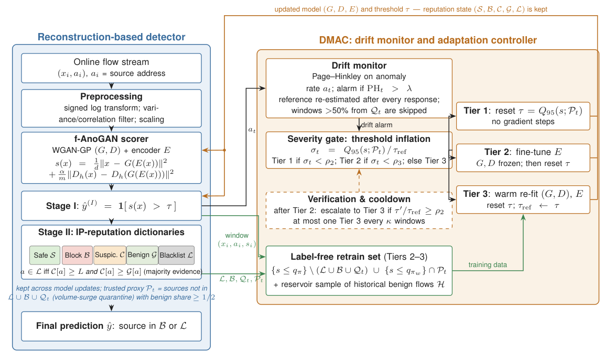

# DRIFT-DDA

Code and results for **"DRIFT-DDA: Severity-Gated, Reputation-Aware Adaptation of Unsupervised Network
Intrusion Detection under Natural Drift"** (Amr H. Abdelhaliem, Irbid National University; manuscript under
review).

DRIFT-DDA is a label-free adaptation controller for an unsupervised f-AnoGAN network intrusion detector with
per-address IP reputation (GAN-DDA dictionaries). When a Page–Hinkley monitor raises a drift alarm, it
measures how far the score percentile of reputation-trusted traffic has inflated and picks the cheapest
response that should suffice: reset the alarm threshold, fine-tune the encoder, or warm re-fit the whole
model. It escalates when an update does not restore the fit. Thresholds and retrain sets are estimated on
trusted traffic. A majority-evidence blacklist and a volume-surge quarantine keep drifted benign hosts and
suddenly dominant sources from corrupting reputation and adaptation.



## What the evaluation covers

- **Real traces in timestamp order with their real IP addresses**: UNSW-NB15 full records, the corrected
  CICIDS2017 (Engelen et al.), and NF-ToN-IoT-v3, which was held out from all design and tuning (1-in-10
  systematic sample).
- **Attacker address rotation** on every real trace (a share *p* of attack flows moved to never-seen addresses).
- **Controlled synthetic streams**: easy and hard attacks; abrupt, gradual, recurring and novel-attack drift;
  a no-drift control; a severity sweep.
- **Baselines** sharing the identical pipeline: static, periodic, Tier-1-only, Tier-2-only, Tier-3-only
  (drift-triggered full retraining), and a label-free SSF-style policy (supplementary only).
- **Analyses**: ablations, injected-shift retrain-set composition, slow poisoning, a quality–cost frontier,
  one-at-a-time sensitivity, and wall-clock cost per tier against model width.
- **Tuning**: the gate parameters (λ, ρ2, ρ3) were tuned once on held-out synthetic seeds 100–104 with a
  pre-stated rule, then frozen for every test stream (`results/tuning_selected.json`).

### Headline results (10 configurations unless noted)

| Real trace | static F1 | Tier-1-only | Tier-3-only (steps) | **DRIFT-DDA** (steps) |
|---|---|---|---|---|
| UNSW-NB15 | 0.647 | 0.414 ± 0.160 | 0.631 (28,711) | **0.643** (3,132) |
| CICIDS2017 | 0.946 | 0.915 | 0.941 (5,158) | **0.914** (1,230), median 0.949 |
| NF-ToN-IoT-v3 (held out) | 0.637 (FPR 0.47) | 0.146 | 0.234 (3,287) | **0.390** (1,745), FPR 0.035 |

- Recomputing the threshold alone is unreliable on real traffic.
- DRIFT-DDA is at least as accurate as retraining on every alarm, with 1.9–9.2× fewer optimizer steps.
- When a few persistent addresses carry the attacks, a static reputation-backed detector is hard to beat
  on final F1; DRIFT-DDA ties it.
- Under full attacker-address rotation, DRIFT-DDA keeps its UNSW-NB15 F1 (0.642), while static and
  Tier-3-only fall to 0.603.
- **Limits, reported in the paper**:
  - Volumetric attacks from fresh addresses poison every label-free policy on CICIDS2017.
  - On the held-out IoT trace the configured detector is near chance.
  - Slow poisoning from fresh addresses partly succeeds.

All numbers come from `results/results_v7.json`; `results/tables/` and `results/figures/` are generated
from it.

## Repository layout

```
code/                 detector, controller, streams, experiments, runner, aggregation, tables, figures
  core.py             f-AnoGAN, GAN-DDA dictionaries (+ majority blacklist), surge quarantine, DMAC, run_stream
  streams.py          synthetic family, real traces (timestamp order, real addresses, rotation), injected shift
  config.py           frozen v7 design and model/dictionary parameters
  prep_real.py        one-time caches of the three real traces
  tune.py             held-out tuning of (lambda, rho2, rho3)
  experiments.py      every experiment in the paper (+ the post-hoc variants, reported separately)
  runner.py           resumable multiprocessing runner; one JSON log per run
  metrics.py, aggregate.py, make_tables.py, figures.py, data_table.py, cost_bench.py
  tools/              author's queue/packaging helpers (Windows scheduled task, LaTeX packaging)
  design_phase/       pilots and diagnostics used while designing v7 (kept for transparency)
results/
  results_v7.json     every aggregated number (means, 95% CIs, per-configuration values, paired tests)
  tuning_selected.json, data_table.json, cost_*.json, diag_ton.json, heldout_first_run_with_identifier.json
  tables/, figures/   generated LaTeX tables, numbers.tex macros, figures (PDF + PNG)
```

The per-run logs (one JSON per run, 5,287 runs, 176 MB unpacked) are attached to the GitHub release as
`DRIFT_DDA_v7_run_logs.zip`. Unpack them into `results/raw/` to re-aggregate.

## Data

The traces are public; download them from their providers and point the environment variables at them.

| Trace | Provider | Variable (default under `data/raw/`) |
|---|---|---|
| UNSW-NB15 full records with `srcip`/`dstip`/`Stime` (parquet) | UNSW Canberra | `DDA_UNSW_DIR` |
| CICIDS2017, corrected release (`monday.csv` … `friday.csv`) | Engelen et al., imec-DistriNet | `DDA_CIC_DIR` |
| NF-ToN-IoT-v3 (`NF-ToN-IoT-v3.zip`) | University of Queensland NetFlow v3 datasets | `DDA_TON_ZIP` |

Addresses, ports, timestamps and connection identifiers (TCP initial sequence numbers, DNS transaction IDs)
are never model inputs.

## Reproduce

Tested with Python 3.11.9 on Windows 11, CPU only (one thread per run).

```bash
pip install -r requirements.txt
cd code
python prep_real.py unsw cic ton          # one-time caches in ../data/
python tune.py run 4                      # held-out tuning -> ../results/tuning_selected.json
python experiments.py real,heldout,rotation,synth,ablation,injected,poison,severity,frontier,sensitivity,posthoc 4
python cost_bench.py --device cpu --threads 1 --out ../results/cost_cpu1.json
python aggregate.py && python make_tables.py && python figures.py
```

The full set of runs took about 9 hours of wall-clock time with 4–6 parallel workers on a 6-core CPU. Every run writes `results/raw/<experiment>/<tag>__s<seed>.json`
and is skipped if that file exists, so interrupted runs resume where they stopped. To regenerate only the
tables and figures from the released results, run `python make_tables.py && python figures.py`; Figure 2
also needs the run logs.

### Edge-device cost

`cost_bench.py` runs unchanged on a Raspberry Pi 4/5 with 64-bit OS
(`pip install torch numpy scipy scikit-learn pandas`):

```bash
python cost_bench.py --device cpu --threads 4 --out ../results/cost_pi4t.json
```

## License

MIT; see `LICENSE`.
